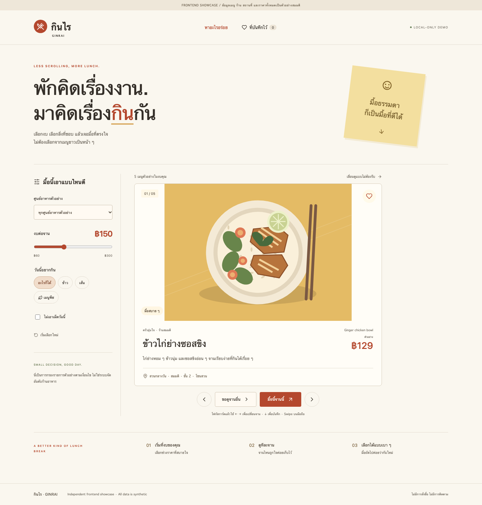

# กินไร · GinRai showcase

A Thai-first dish-discovery frontend: a small, focused way to explore lunch by budget,
place and preference. This public edition is **independently implemented** from the
requested experience. It does not extract the private GinRai implementation.

**Synthetic menu, shop, location and price data · No ordering, APIs or tracking.**



## Explore the experience

- Filter six fictional dishes by budget, mock food court, category and mild-food preference.
- Browse one illustrated dish at a time using buttons, card keyboard shortcuts or swipes.
- Open an accessible selection dialog with sample ingredients and explicit simulation limits.
- Save favorites locally and revisit them after reload; blocked storage falls back to session state.
- Recover from empty results and reset filters.
- Original vector food illustrations, responsive Thai typography and reduced-motion support.

Results retain fixture order. There is no restaurant ranking, paid promotion,
commercial recommendation algorithm, verified price feed or allergen certification.

## Run locally

Node.js 24 and npm are required. No environment file, provider account or backend is needed.

```sh
npm ci
npm run dev
```

Open http://127.0.0.1:4314. `npm run build` produces `dist/`;
`npm run preview` serves that static artifact locally. Relative asset paths support subdirectory hosting.
No hosted application deployment is implied by repository publication.

## Try a lunch break

Set a budget, select เมนูพืช and toggle ไม่เอาเผ็ดวันนี้. Try a different sample food court
and recover from an empty result. Reset, choose ขอดูจานอื่น, open มื้อนี้จานนี้ and save
the dish. Reload and visit ที่บันทึกไว้. No purchase or reservation takes place.

Focus the dish card and use `←` / `→` to browse, or `↓` to save. These shortcuts do not
intercept form controls or buttons. Touch users can swipe horizontally on the dish.

[Tablet screenshot](docs/screenshots/tablet.png) · [Mobile screenshot](docs/screenshots/mobile.png)

## Verification

```sh
npm run check
npm audit --audit-level=high
npx playwright install chromium
PREVIEW=1 npm run test:e2e
```

`check` runs lint, typecheck, unit tests and the production build. Browser checks exercise
filtering, selection, local favorites, empty recovery, keyboard navigation, denied storage,
axe accessibility, overflow and external-request/error boundaries at 1440/1024/390 pixels.
See [executed release checks](docs/RELEASE_CHECKS.md) for observed evidence.

## Structure and boundaries

React + TypeScript + Vite. `src/model.ts` owns typed synthetic fixtures and pure filtering;
`src/App.tsx` composes the discovery/saved views and original SVG illustrations;
`src/styles.css` defines the responsive visual system. State stays in React, with optional
favorites in browser LocalStorage. UI state is user-controlled and never authorization.

- [Architecture](docs/ARCHITECTURE.md)
- [Decisions](docs/DECISIONS.md)
- [Public inclusion allowlist](docs/PUBLIC_ALLOWLIST.md)
- [Security and privacy](SECURITY.md)
- [Contributing](CONTRIBUTING.md)
- [Dependency notices](docs/THIRD_PARTY.md)

## Known limitations

All dishes, stores, food courts, prices and ingredients are fictional examples. Do not use
these records for dietary, allergy, travel or purchasing decisions. No actual ordering,
payment, stock, authentication, database, scraping, merchant integration or analytics exists.
Favorites stay on this browser/device and are not synchronized. This is a prototype/showcase,
not a production meal-discovery service.

## Ownership and license

Owned by `tpeak5237` and independently authored with AI-assisted development. No private
GinRai source, ranking, schemas, commercial strategies, operational configuration, history,
photos or business records were copied. MIT covers the new source; third-party packages retain
their licenses. React/React DOM/Scheduler MIT and Lucide ISC notices are preserved.
See [LICENSE](LICENSE).
